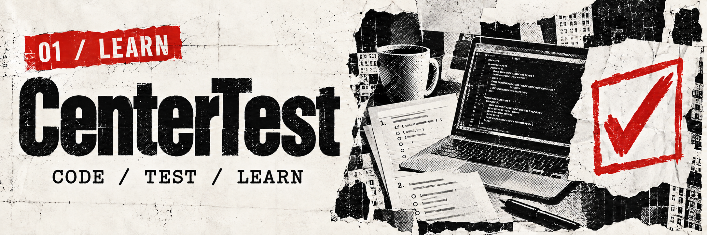

  

## Danila / Java & full-stack

Hi, I'm **Danila**. I build web applications, APIs and tools that make learning more practical. I work with **Java, Spring Boot and TypeScript**, connecting interfaces, application logic and data into complete products.

My main project is **CenterTest**, a platform for programming education, assessments and collaborative lessons.

---

### Featured project / CenterTest

**A place to code, test and learn together.**

CenterTest brings programming exercises, assessments and teaching tools into one platform:

- Coding tasks with automated checks and manual review.
- Study groups and a shared code editor for live lessons.
- An interactive Java course with hands-on exercises.

**TypeScript · React · Cloudflare Workers · D1 · WebSocket**

[Explore CenterTest ↗](https://centertest.borodinda.workers.dev/) · Source code is currently private.

---

### Also building / Business OS

[Business OS: Digital Clinic](https://github.com/Denzel-is/Business-OS-Digital-Clinic) is a project for exploring business workflows and turning operational problems into digital solutions.

Java 21 · Spring Boot · Next.js · PostgreSQL · Redis · Docker

---

### Tools of the trade

| Area | Technologies |
| :--- | :--- |
| **Java / backend** | Java · Spring Boot · REST API |
| **Web** | TypeScript · React · Next.js |
| **Data** | PostgreSQL · Redis · SQLite / D1 |
| **Ship** | Docker · Git · GitHub Actions · Cloudflare Workers |
| **Also** | Python · Django · C++ · Flutter |

---

<b>CODE / LEARN / BUILD / REPEAT</b> DENZEL-IS · Good code. Better days.

