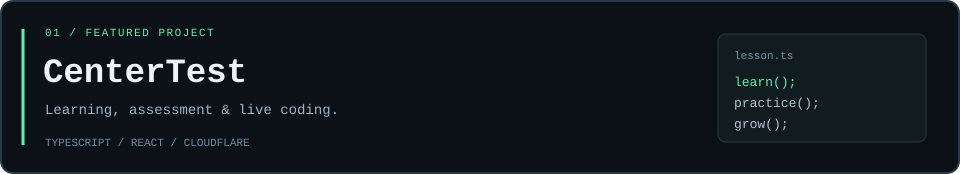
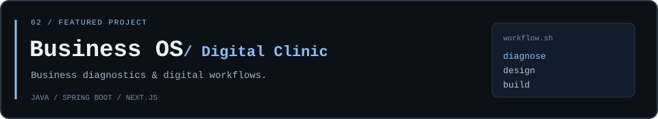
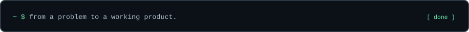

  

  <a href="#-whoami"><code>about</code></a> &nbsp; / &nbsp;
  <a href="#-ls-projects"><code>projects</code></a> &nbsp; / &nbsp;
  <a href="#-cat-stack"><code>stack</code></a>

### `$ whoami`

Привет, я **Данила** — разрабатываю веб-приложения, API и инструменты, которые помогают учиться и решать задачи бизнеса.

Мои основные проекты сейчас — **CenterTest** и **Business OS: Digital Clinic**. Мне интересно собирать продукт целиком: от понятного интерфейса и логики приложения до базы данных и развёртывания.

### `$ ls projects/`

Тесты и задания по программированию, автоматическая проверка, учебные группы и совместный редактор для живых уроков.

`TypeScript` · `React` · `Cloudflare Workers` · `D1` · `WebSocket`

**[Открыть CenterTest ↗](https://centertest.borodinda.workers.dev/)** &nbsp; · &nbsp; Исходный код в закрытом репозитории.

 

Веб-приложение для диагностики операционных проблем бизнеса: интерактивный опрос, демонстрационные кейсы и сценарии обращения за IT-решениями.

`Java` · `Spring Boot` · `Next.js` · `TypeScript` · `PostgreSQL` · `Redis` · `Docker`

**[Посмотреть проект ↗](https://github.com/Denzel-is/Business-OS-Digital-Clinic)**

### `$ cat stack`

| Область | Технологии |
| :--- | :--- |
| **Frontend** | TypeScript · React · Next.js |
| **Backend** | Java · Spring Boot · Python · Django |
| **Data** | PostgreSQL · Redis · SQLite / D1 |
| **Infrastructure** | Cloudflare Workers · Docker · Git · GitHub Actions |
| **Также работаю с** | C++ · SFML · Dart · Flutter |

 

