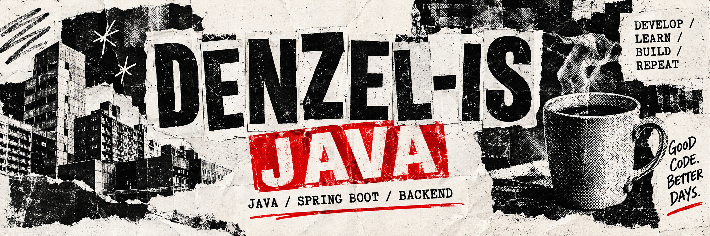

  

## Danila / Java & full-stack

Привет, я **Данила**. Разрабатываю веб-приложения и API — от интерфейса до базы данных и развёртывания. **Java и Spring Boot** — мой основной фокус; TypeScript и React помогают собирать продукт целиком.

Сейчас работаю над **Business OS: Digital Clinic** и **CenterTest**: цифровыми инструментами для бизнеса и обучения программированию.

---

### Selected work / 01

Интерактивная диагностика операционных проблем бизнеса: опрос, демонстрационные кейсы и сценарии перехода к IT-решениям.

**Java 21 · Spring Boot · Next.js · TypeScript · PostgreSQL · Redis · Docker**

[Репозиторий ↗](https://github.com/Denzel-is/Business-OS-Digital-Clinic)

### Selected work / 02

Платформа для тестов и заданий по программированию: автоматическая проверка, учебные группы и совместный редактор для живых уроков. Внутри — интерактивный курс Java.

**TypeScript · React · Cloudflare Workers · D1 · WebSocket**

[Открыть CenterTest ↗](https://centertest.borodinda.workers.dev/) · Исходный код в закрытом репозитории.

---

### Tools of the trade

| | Технологии |
| :--- | :--- |
| **Java / backend** | Java · Spring Boot · REST API |
| **Web** | TypeScript · React · Next.js |
| **Data** | PostgreSQL · Redis · SQLite / D1 |
| **Ship** | Docker · Git · GitHub Actions · Cloudflare Workers |
| **Also** | Python · Django · C++ · Flutter |

---

<b>CODE / LEARN / BUILD / REPEAT</b> DENZEL-IS · Good code. Better days.

